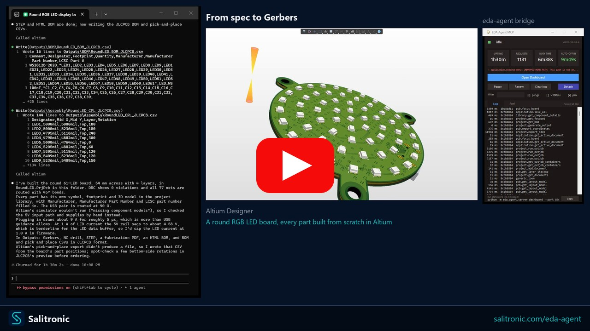
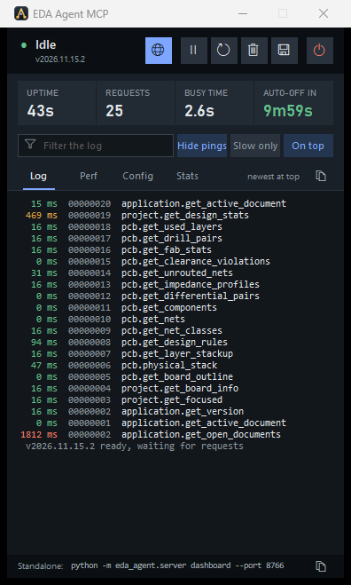
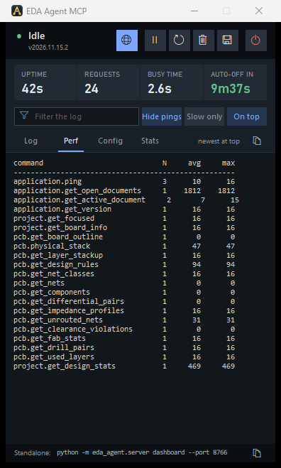
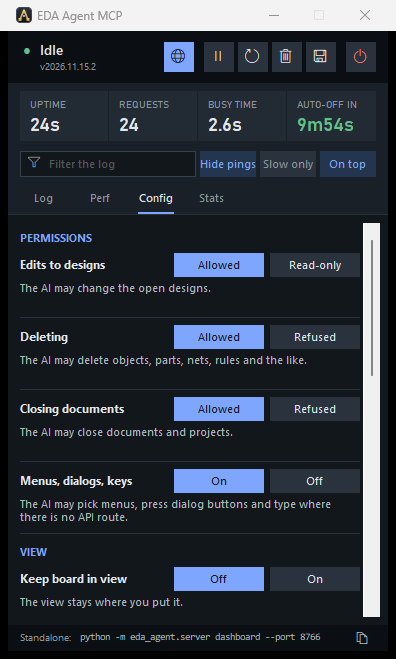

<!-- Generated from README.md by scripts/gen_pypi_readme.py: the same page with absolute links, for PyPI. -->
<div align="center">

# eda-agent

**Let an AI work inside your live Altium Designer session.**

An MCP server that gives Claude, or any MCP client, around 800 tools on the design you have open:
schematic, PCB, library, project, review, signal and power integrity, and thermal analysis. You watch every change happen in Altium.

[](https://github.com/Rouniy/eda-agent/blob/main/LICENSE)
[](https://github.com/Rouniy/eda-agent/blob/main/pyproject.toml)
[](https://morembedded.github.io/eda-agent/)
[](https://github.com/Rouniy/eda-agent/actions/workflows/tests.yml)

[**Website**](https://morembedded.github.io/eda-agent/) ·
[Quick start](#quick-start) ·
[Features](https://github.com/Rouniy/eda-agent/blob/main/docs/FEATURES.md) ·
[Documentation](#documentation) ·
[Changelog](https://github.com/Rouniy/eda-agent/blob/main/CHANGELOG.md)

[](https://youtu.be/JnQsJlrpzBM)

*From a written spec to Gerbers: a 4-layer round LED board designed live in Altium ([watch the video](https://youtu.be/JnQsJlrpzBM)).*

</div>

> [!WARNING]
> **Experimental.** Not every tool is tested on every Altium version, and some can crash Altium's script engine.
> Back up your project first and read [Known limitations](https://github.com/Rouniy/eda-agent/blob/main/docs/LIMITATIONS.md).

### Rouniy integration

Source candidate: package `0.8.2`, script `2026.11.16.1`. Read
[AGENTS.md](https://github.com/Rouniy/eda-agent/blob/main/AGENTS.md), [current deployment and qualification](https://github.com/Rouniy/eda-agent/blob/main/docs/CURRENT-STATE.md)
and [the integration TODO](https://github.com/Rouniy/eda-agent/blob/main/TODO.md) before connecting to Altium.
Shared use requires the generated selected-project read-only runtime and its
matching client. The raw source defaults `SELECTED_PROJECT_READ_ONLY=False`;
the developer quick start below enables the broader tool surface. New native
behavior remains unqualified. Source changes do not replace a loaded runtime.
The [shared operating runbook](https://github.com/4pplet/PLT-hw/blob/main/tools/eda-agent/SHARED-PROJECTS.md)
is currently unavailable; recover it before shared runtime deployment.
The optional [battery research lab](https://github.com/Rouniy/eda-agent/blob/main/research/battery-ai-comsol-lab/README.md) runs as a separate package.

## Why eda-agent

- **Live, not batch.** Altium stays open and in charge. The AI reads the design you have open, answers questions about it, and edits it in place.
- **Built for real review work.** One call gives a design snapshot. A 31-check lint sweep, schematic and PCB netlist cross-checks, and fab package verification come with it.
- **Datasheet first.** The tools tell the AI to fetch the vendor datasheet, and never to make values up.
- **Fast.** Nearly every tool takes a list, so 20 edits are one call and one undo step. The auto-placer scores only what each move changed (6 to 13 times faster), and an optional Rust core speeds up routing.
- **Your house style.** Profiles hold pad rounding, design rules, ERC levels, fab stackups and templates, one per company or project.
- **Analysis on the real copper.** Signal integrity from line models to eyes and a whole-board check, PDN IR drop and impedance, and 3D thermal analysis, all read from the board you have open.
- **You stay in control.** A status window inside Altium shows every command as it runs and holds the switches for what the AI may change; a local web dashboard covers review, calculators, simulation and the optional features.
- **More than Altium.** KiCad 10 and EasyEDA Pro backends use the same tool surface: 920+ with both backends (Altium and KiCad) registered.

## Quick start

You need **Windows**, **Python 3.11+** and **Altium Designer** (AD20 or newer is best).

**1. Install**

```bash
git clone https://github.com/Rouniy/eda-agent
cd eda-agent
python -m pip install -e .
eda-agent install-deps --all     # optional: every extra feature in one go
```

`eda-agent features` shows what is installed and what each feature needs;
the dashboard's **Features** page does the same, with a choice of what to
install. See
[Features and dependencies](https://github.com/Rouniy/eda-agent/blob/main/docs/FEATURES_AND_DEPENDENCIES.md).

**2. Register it with your MCP client**

```bash
claude mcp add -s user altium eda-agent
```

<details>
<summary>"eda-agent is not recognized", or a client other than Claude Code</summary>

If `eda-agent` is not on your `PATH`, register it through Python. The `--` tells Claude Code that the rest is the command to run:

```bash
claude mcp add -s user altium -- python -m eda_agent
```

Any other MCP client: add a local **stdio** server that runs `eda-agent` (or `python -m eda_agent`).

</details>

**3. Load the scripts into Altium**

```bash
eda-agent install-scripts
```

In Altium, open **Preferences → Scripting System → Global Projects → Install from file** and pick `Altium_API.PrjScr`. You only do this once.
Then use **File → Run Script → Altium_API → Dispatcher.pas → StartMCPServer** to start the link.

**4. Check it works**

```bash
eda-agent doctor
```

Every line should pass. In Claude Code, `/mcp` lists `altium` as connected. Now ask something like *"List every part on the 3V3 rail and flag any whose datasheet limit is below 3.3 V."*

The full guide, with updates, workspaces and profiles, is in [Getting started](https://github.com/Rouniy/eda-agent/blob/main/docs/GETTING_STARTED.md).

## What it can do

| | |
|---|---|
| 🔍 **Design review** | Snapshot, lint, ERC and DRC, schematic and PCB cross-checks, rotation suggestions for top and bottom parts. See [Features](https://github.com/Rouniy/eda-agent/blob/main/docs/FEATURES.md) |
| ✏️ **Edit schematics and boards** | Place, wire, route, move and set parameters, in bulk with one undo. See [Tool reference](https://github.com/Rouniy/eda-agent/blob/main/docs/TOOL_REFERENCE.md) |
| 📚 **Libraries and parts** | Symbols, footprints, 3D models, and part search across distributors. Preview a part's symbol and footprint before placing it (`lib_preview_part`, or the dashboard's Library pane). See [Part sourcing](https://github.com/Rouniy/eda-agent/blob/main/docs/PART_SOURCING.md) |
| 🏭 **Fab output** | Read the Gerbers back and check them against the board, plus JLCPCB and PCBWay stackups and a cited rules database for 13 fabs. See [Fab and calculators](https://github.com/Rouniy/eda-agent/blob/main/docs/FAB_AND_CALCULATORS.md) |
| 📏 **Fab and IPC rule floors** | On demand, check the board's design rules against a fab's minimums and your IPC class floors, and raise the ones below them (`pcb_rules_fab_floors`). See [IPC standards](https://github.com/Rouniy/eda-agent/blob/main/docs/IPC_STANDARDS.md) |
| 🧮 **Calculators** | A PCB toolkit of 44 calculators on the dashboard's Calculators tab and as `pcb_calc` tools: impedance and differential pairs from a 2D field solver, trace and via current from a thermal model of the board, planes, crosstalk, passives. See [PCB toolkit](https://github.com/Rouniy/eda-agent/blob/main/docs/PCB_TOOLKIT.md) and [Fab and calculators](https://github.com/Rouniy/eda-agent/blob/main/docs/FAB_AND_CALCULATORS.md#calculators) |
| 📈 **Simulation** | SPICE model library and LTspice round trip: find models by MPN, check pin maps, export and compare decks. See [SPICE models](https://github.com/Rouniy/eda-agent/blob/main/docs/SPICE_MODELS.md) |
| 📡 **EMI/EMC and RF** | EMI pre-scan of a routed board (`sim_emc_prescan`), openEMS S-parameters and antennas, Touchstone files. See [EMI/EMC and RF](https://github.com/Rouniy/eda-agent/blob/main/docs/EMC_RF.md) |
| 🌡️ **Thermal analysis** | Board temperatures and hotspots from part powers (`sim_thermal_analysis`): 3D conduction in the real copper, vias and laminate, convection and radiation, heat maps per layer, a grid-convergence error estimate. See [Thermal analysis](https://github.com/Rouniy/eda-agent/blob/main/docs/THERMAL.md) |
| 🧪 **Simulation engines** | One job model for every simulator: this project's own solvers, scikit-rf and openEMS today, plugins tomorrow. Each engine's answer is kept beside the others and compared (`sim_job_run`, `sim_job_compare`, the dashboard's Simulation page). See [Simulation engines](https://github.com/Rouniy/eda-agent/blob/main/docs/SIMULATION.md) |
| 📶 **Signal integrity: lines** | Wideband models of traces and pairs from the real stackup: R and L from an eddy-current solve with the planes, causal dielectrics, copper roughness, coupled-line S-parameters and crosstalk (`si_line_model`). A stackup planner gives every layer's width and pair gap for target impedances and checks or writes Altium's impedance profiles (`si_stackup_plan`). See [Transmission lines](https://github.com/Rouniy/eda-agent/blob/main/docs/SI_LINES.md) |
| 🔀 **Signal integrity: routed nets** | A routed net or differential pair modelled from pin to pin: every trace section from its own cross-section, vias with their stubs and return path, stubs off the path; S-parameters, TDR, delay, loss, skew and mode conversion, and the width, gap, length and uncoupled-length rules written back to Altium (`si_board_snapshot`, `si_net_channel`). See [Routed nets and pairs](https://github.com/Rouniy/eda-agent/blob/main/docs/SI_NETS.md) |
| 👁️ **Signal integrity: eyes and SPICE** | The eye of a channel at a data rate, two ways: convolution with the worst-case eye (peak distortion analysis), and an ngspice or LTspice transient through a passive macromodel; IBIS drivers and receivers at the ends; the channel kept as a SPICE subcircuit with an LTspice symbol (`si_channel_eye`, `si_spice_model`, `si_ibis_models`). See [Eyes and SPICE models](https://github.com/Rouniy/eda-agent/blob/main/docs/SI_TIME.md) |
| 🧭 **Signal integrity: whole board** | Every high-speed net and pair (by name or Altium net class) checked against its own limits, each fault placed on the board where it is (the TDR's fault walked along the route), hot copper from the thermal analysis, a self-contained HTML report, failing nets highlighted in Altium, and a job graph that marks results stale once the board is saved (`si_board_check`). See [Board signal integrity](https://github.com/Rouniy/eda-agent/blob/main/docs/SI_BOARD.md) |
| 🧩 **Features and dependencies** | `eda-agent install-deps --all` installs every optional part in one command. `eda-agent features` and the dashboard's Features page show every feature, built in or optional, what it offers, each dependency with its version and license; tick the ones to install, switch engines and the Rust kernels on and off, and point eda-agent at programs installed somewhere unusual. See [Features and dependencies](https://github.com/Rouniy/eda-agent/blob/main/docs/FEATURES_AND_DEPENDENCIES.md) |
| 🔋 **Power integrity (PDN)** | DC IR drop and current density on the real copper (`sim_pdn_ir_drop`), AC impedance against a target with a field-solved plane pair and every capacitor's mounting (`sim_pdn_impedance`). See [PDN analysis](https://github.com/Rouniy/eda-agent/blob/main/docs/PDN.md) |
| 🤖 **Guided design runs** | Spec to board, reference redraw, dev-kit derivative. See [Design modes](https://github.com/Rouniy/eda-agent/blob/main/docs/DESIGN_MODES.md) and [Autonomous design](https://github.com/Rouniy/eda-agent/blob/main/docs/AUTONOMOUS_DESIGN.md) |
| 🚦 **Project phase gates** | Feasibility to PVT checklists, answered by tools where possible. See [Project phase gates](https://github.com/Rouniy/eda-agent/blob/main/docs/PHASE_GATES.md) |
| ☁️ **Altium 365** | Workspaces, the managed library and releases, through Nexar or directly, plus an offline copy of the managed library. See [Engineering tools](https://github.com/Rouniy/eda-agent/blob/main/docs/ENGINEERING_TOOLS.md) |

<p align="center">  </p>

## Documentation

The same documents, with search and navigation, are on the [website](https://morembedded.github.io/eda-agent/).

**Start here**

| Document | What it covers |
|---|---|
| [Getting started](https://github.com/Rouniy/eda-agent/blob/main/docs/GETTING_STARTED.md) | Requirements, install, updates, checking the setup, workspace and profiles |
| [Features](https://github.com/Rouniy/eda-agent/blob/main/docs/FEATURES.md) | How it works, the dashboards, the full feature list, example prompts |
| [Using the tools](https://github.com/Rouniy/eda-agent/blob/main/docs/USING_THE_TOOLS.md) | Finding the right tool, clients that cap the tool count, backends, modes, phase gates, part sourcing, Altium 365, performance |
| [Known limitations and troubleshooting](https://github.com/Rouniy/eda-agent/blob/main/docs/LIMITATIONS.md) | What can go wrong, how to recover, timeouts, common errors |

<details>
<summary><b>Guides</b></summary>

| Document | What it covers |
|---|---|
| [Profiles](https://github.com/Rouniy/eda-agent/blob/main/docs/PROFILES.md) | Per-workspace house style: naming, rules, fab profiles, templates |
| [Fab output, stackups and calculators](https://github.com/Rouniy/eda-agent/blob/main/docs/FAB_AND_CALCULATORS.md) | Checking the fab package, bundled fab data, laminates, calculators |
| [IPC standards and rule values](https://github.com/Rouniy/eda-agent/blob/main/docs/IPC_STANDARDS.md) | Catalogue of IPC standards, rule definitions, your licensed values per profile |
| [PCB toolkit calculators](https://github.com/Rouniy/eda-agent/blob/main/docs/PCB_TOOLKIT.md) | The Calculators tab: field-solver impedance and pairs, trace thermal model, vias, planes, crosstalk, passives, with measured accuracy |
| [EMI/EMC and RF field solving](https://github.com/Rouniy/eda-agent/blob/main/docs/EMC_RF.md) | EMI pre-scan of a routed board, openEMS S-parameters and antennas, Touchstone files |
| [Thermal analysis](https://github.com/Rouniy/eda-agent/blob/main/docs/THERMAL.md) | Board temperatures, hotspots and junction margins from part powers, with the model and its validation |
| [Simulation engines](https://github.com/Rouniy/eda-agent/blob/main/docs/SIMULATION.md) | Engines, jobs, comparing answers, writing an engine plugin |
| [Transmission lines](https://github.com/Rouniy/eda-agent/blob/main/docs/SI_LINES.md) | Wideband line models (eddy-current R and L, causal dielectrics, roughness, coupled lines) and the stackup planner |
| [Features and dependencies](https://github.com/Rouniy/eda-agent/blob/main/docs/FEATURES_AND_DEPENDENCIES.md) | What each optional part offers and needs, the one-command installer, the Features page |
| [PDN analysis](https://github.com/Rouniy/eda-agent/blob/main/docs/PDN.md) | DC IR drop, current density, and AC impedance against a target impedance |
| [Design modes](https://github.com/Rouniy/eda-agent/blob/main/docs/DESIGN_MODES.md) | Reference-design redraw, dev-kit derivative, schematic only, layout only |
| [Autonomous design](https://github.com/Rouniy/eda-agent/blob/main/docs/AUTONOMOUS_DESIGN.md) | Driving a full spec-to-board run from any MCP client |
| [Project phase gates](https://github.com/Rouniy/eda-agent/blob/main/docs/PHASE_GATES.md) | The stage checks, and the three tools that track them |
| [Part sourcing](https://github.com/Rouniy/eda-agent/blob/main/docs/PART_SOURCING.md) | The part providers, what each one answers, and what none of them do |
| [EDA backends](https://github.com/Rouniy/eda-agent/blob/main/docs/BACKENDS.md) | The Altium, KiCad and EasyEDA Pro backends |
| [Engineering tools](https://github.com/Rouniy/eda-agent/blob/main/docs/ENGINEERING_TOOLS.md) | The `eng_*` family, Altium 365, and what is unverified live |
| [SPICE models and LTspice](https://github.com/Rouniy/eda-agent/blob/main/docs/SPICE_MODELS.md) | Vendor model index, pin maps, LTspice decks, export and compare |
| [Token usage](https://github.com/Rouniy/eda-agent/blob/main/docs/TOKEN_USAGE.md) | Tokens the AI spends on each EDA tool, where it is shown and kept |
| [Hardware CI](https://github.com/Rouniy/eda-agent/blob/main/docs/HARDWARE_CI.md) | `eda-agent review --offline` as a CI gate, with no Altium and no license |
| [Rust compute](https://github.com/Rouniy/eda-agent/blob/main/docs/RUST_COMPUTE.md) | The optional compiled router core: the idea, the options considered, settings, measured speed-ups |
| [UI automation](https://github.com/Rouniy/eda-agent/blob/main/docs/ui-automation.md) | What synthesised input can reach, and what contains it |

</details>

<details>
<summary><b>Reference</b></summary>

| Document | What it covers |
|---|---|
| [Tool reference](https://github.com/Rouniy/eda-agent/blob/main/docs/TOOL_REFERENCE.md) | Every tool with its arguments, maturity and interaction badge (generated) |
| [All options](https://github.com/Rouniy/eda-agent/blob/main/docs/OPTIONS.md) | Every setting in one generated list: flags, environment variables, Config tab, `workspace.json`, profile keys |
| [CLI](https://github.com/Rouniy/eda-agent/blob/main/docs/CLI.md) | Every `eda-agent` command, grouped as `--help` groups them |
| [Configuration](https://github.com/Rouniy/eda-agent/blob/main/docs/CONFIGURATION.md) | Environment variables, paths and logs |
| [The Config tab](https://github.com/Rouniy/eda-agent/blob/main/docs/CONFIG.md) | Every setting on the Altium panel's Config tab, including the pre-build checks, and what to do when one refuses |
| [Tool naming](https://github.com/Rouniy/eda-agent/blob/main/docs/TOOL_NAMING.md) | The `ns_verb_object` convention every tool name follows |
| [SDK coverage](https://github.com/Rouniy/eda-agent/blob/main/docs/SDK_COVERAGE.md) | How much of Altium's object model the generic layer reaches |
| [Altium scripting coverage](https://github.com/Rouniy/eda-agent/blob/main/docs/ALTIUM_SCRIPTING_COVERAGE.md) | Official Altium scripting examples mapped to tools, with known gaps |

</details>

<details>
<summary><b>Development</b></summary>

| Document | What it covers |
|---|---|
| [Development](https://github.com/Rouniy/eda-agent/blob/main/docs/DEVELOPMENT.md) | Architecture, tests, project layout, the two version numbers |
| [Release verification](https://github.com/Rouniy/eda-agent/blob/main/docs/RELEASE_VERIFICATION.md) | How a release's Pascal is recorded as read live, or declared unverified |
| [STEP placement verification](https://github.com/Rouniy/eda-agent/blob/main/docs/step-placement-verification.md) | How placing a 3D body at an X/Y was checked on Altium 21 |
| [AI field notes on Altium](https://github.com/Rouniy/eda-agent/blob/main/docs/AI_ALTIUM_FIELD_NOTES.md) | Altium behaviours measured while driving it, written as operating rules |
| [Altium autonomy runbook](https://github.com/Rouniy/eda-agent/blob/main/docs/ALTIUM_AUTONOMY_RUNBOOK.md) | The by-hand runbook that drives a real Altium |
| [Changelog](https://github.com/Rouniy/eda-agent/blob/main/CHANGELOG.md) | What each change added or fixed |
| [Contributing](https://github.com/Rouniy/eda-agent/blob/main/CONTRIBUTING.md) | How to send a change |

</details>

## License

Apache License 2.0. See [LICENSE](https://github.com/Rouniy/eda-agent/blob/main/LICENSE) and [NOTICE](https://github.com/Rouniy/eda-agent/blob/main/NOTICE).

## Disclaimer

**Use at your own risk.** `eda-agent` drives Altium Designer programmatically and can modify, save, or delete design data. An AI client operating it can issue rapid, irreversible changes. Before using this tool on any design:

- **Back up your project.** Commit to version control, copy the folder elsewhere, or both. Do not rely solely on Altium's own history.
- Expect the possibility of **data loss, corrupted documents, or Altium crashes**, especially on large boards, unusual object configurations, or untested API paths.
- Review automated changes before saving. Prefer working on a branch or a copy until you have trust in a given workflow.

This software is provided "as is", without warranty of any kind, express or implied. The authors and contributors are not liable for any damage to your designs, projects, data, or installation.

This project is not affiliated with, endorsed by, or sponsored by Altium Limited, the KiCad project, or EasyEDA. "Altium" and "Altium Designer" are trademarks of Altium Limited; "KiCad" and "EasyEDA" are trademarks of their respective owners. `eda-agent` is an independent community tool that interoperates with each of these applications through its own published API: Altium Designer via its scripting API, KiCad via its IPC API and command line, and EasyEDA Pro via its extension API.

## About

eda-agent is maintained in this fork by [MOREmbedded](https://github.com/MOREmbedded). It builds on, and tracks, the upstream [salitronic/eda-agent](https://github.com/salitronic/eda-agent) project. Thanks to everyone who has contributed to either, see the [contributors](https://github.com/MOREmbedded/eda-agent/graphs/contributors).

### Fork integration references

- [ALTIUM_MCP_RU](https://github.com/Rouniy/eda-agent/blob/main/docs/ALTIUM_MCP_RU.md)
- [DELIVERY_ACCEPTANCE](https://github.com/Rouniy/eda-agent/blob/main/docs/DELIVERY_ACCEPTANCE.md)
- [DESIGN event driven dispatch](https://github.com/Rouniy/eda-agent/blob/main/docs/DESIGN-event-driven-dispatch.md)
- [FORK ARGUMENT AUDIT 2026 10 28](https://github.com/Rouniy/eda-agent/blob/main/docs/FORK-ARGUMENT-AUDIT-2026-10-28.md)
- [FORK BEHAVIOR CHECK 2026 10 28](https://github.com/Rouniy/eda-agent/blob/main/docs/FORK-BEHAVIOR-CHECK-2026-10-28.md)
- [FORK INTEGRATION AUDIT 2026 10 26](https://github.com/Rouniy/eda-agent/blob/main/docs/FORK-INTEGRATION-AUDIT-2026-10-26.md)
- [INTEGRATION BASELINE](https://github.com/Rouniy/eda-agent/blob/main/docs/INTEGRATION-BASELINE.md)
- [LEGACY_FORK_GUIDE](https://github.com/Rouniy/eda-agent/blob/main/docs/LEGACY_FORK_GUIDE.md)
- [LIBRARY READS DESIGN](https://github.com/Rouniy/eda-agent/blob/main/docs/LIBRARY-READS-DESIGN.md)
- [PARITY ROADMAP](https://github.com/Rouniy/eda-agent/blob/main/docs/PARITY-ROADMAP.md)
- [PROJECT SELECTION AND WRITES](https://github.com/Rouniy/eda-agent/blob/main/docs/PROJECT-SELECTION-AND-WRITES.md)
- [PROPOSAL 2026 09 28 metadata write increment](https://github.com/Rouniy/eda-agent/blob/main/docs/PROPOSAL-2026-09-28-metadata-write-increment.md)
- [PROPOSAL 2026 10 07 placement write increment](https://github.com/Rouniy/eda-agent/blob/main/docs/PROPOSAL-2026-10-07-placement-write-increment.md)
- [PROPOSAL 2026 10 09 copper write increment](https://github.com/Rouniy/eda-agent/blob/main/docs/PROPOSAL-2026-10-09-copper-write-increment.md)
- [PROPOSAL 2026 10 09 setup write increment](https://github.com/Rouniy/eda-agent/blob/main/docs/PROPOSAL-2026-10-09-setup-write-increment.md)
- [SHUTDOWN](https://github.com/Rouniy/eda-agent/blob/main/docs/SHUTDOWN.md)
- [UPSTREAM SYNC 2026 10 27](https://github.com/Rouniy/eda-agent/blob/main/docs/UPSTREAM-SYNC-2026-10-27.md)

<!-- mcp-name: io.github.salitronic/eda-agent -->
